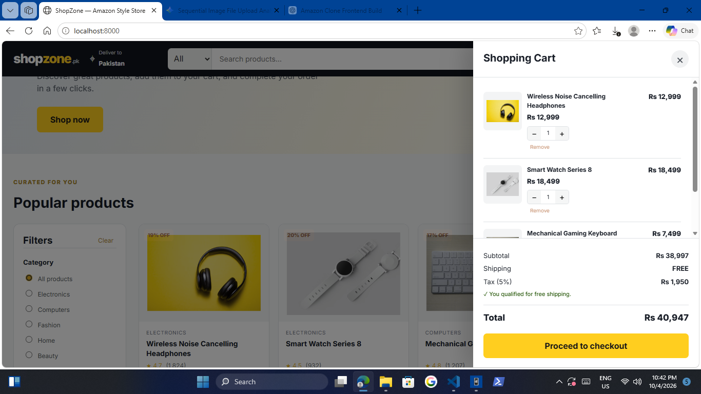

# 🛒 ShopZone — Amazon Style E-Commerce Clone

A professional **Amazon-style frontend e-commerce clone** built with **HTML, CSS, and JavaScript**.

This project demonstrates a complete frontend shopping flow including product browsing, search, category and price filtering, a working shopping cart, automatic price calculations, checkout form validation, local order persistence, order history, JSON export, and responsive layouts.

> **Frontend only:** No React, backend, database, payment gateway, or server-side code is used.

## Preview





## ✨ Features

- 🏠 Professional Amazon-style storefront layout
- 🔎 Product search
- 🗂️ Category filtering
- 💰 Price-range filtering
- ↕️ Product sorting
- ⭐ Product ratings and reviews
- 🛒 Fully working shopping cart
- ➕ Increase product quantity
- ➖ Decrease product quantity
- 🗑️ Remove products from cart
- 💵 Automatic subtotal calculation
- 🚚 Automatic shipping calculation
- 🧾 5% tax calculation
- 💳 Checkout form
- 📱 Mobile responsive design
- 📦 Order confirmation
- 👤 Customer information stored with each order
- 📋 Order history
- 💾 Orders persist using browser `localStorage`
- 📤 Export orders to `shopzone-orders.json`
- 🔐 No real payment is processed
- 🧩 Product details modal
- 📱 Mobile category menu
- ♿ Accessible labels and keyboard-friendly controls

## 🛠️ Technologies Used

- HTML5
- CSS3
- JavaScript (ES6+)
- Browser LocalStorage API
- JavaScript `FormData`
- JavaScript `Blob` API
- Responsive CSS Grid and Flexbox

## 📁 Project Structure

```text
amazon-clone/
│
├── index.html
├── style.css
├── products.js
├── app.js
└── README.md
```

## 🚀 How to Run

1. Download or copy the project files.
2. Keep all four files in the same folder.
3. Open `index.html` in your browser.

For the best development experience, use **VS Code + Live Server**.

## 🛒 Shopping Flow

The application follows this frontend flow:

```text
Products
   ↓
Search / Filter
   ↓
Add to Cart
   ↓
Update Quantity
   ↓
Automatic Price Calculation
   ↓
Checkout Form
   ↓
Place Order
   ↓
Save Order in LocalStorage
   ↓
Order History
   ↓
Export Orders as JSON
```

## 💰 Price Calculation

The cart calculates:

```text
Subtotal = Product Price × Quantity

Shipping:
- Free when subtotal >= Rs. 15,000
- Rs. 350 otherwise

Tax = 5% of subtotal

Total = Subtotal + Shipping + Tax
```

## 💾 Order Data

Because this is a **frontend-only project**, JavaScript cannot directly write into a JSON file inside the project folder.

Instead, the project uses:

```text
localStorage
```

to persist orders in the browser.

The application also includes an **Export Orders** button. It creates a real:

```text
shopzone-orders.json
```

file containing customer and order information.

Example structure:

```json
{
  "exportedAt": "2026-10-04T00:00:00.000Z",
  "orders": [
    {
      "orderId": "SZ-12345678",
      "status": "Order placed",
      "customer": {
        "fullName": "Customer Name",
        "email": "customer@example.com",
        "phone": "+92 300 1234567",
        "address": "House 10, Street 5",
        "city": "Lahore",
        "postalCode": "54000",
        "payment": "Cash on Delivery"
      }
    }
  ]
}
```

## 💳 Payment

The payment section is intentionally a **demo frontend implementation**.

Available options:

- Cash on Delivery
- Card (Demo)

No real payment is processed and no card information is sent anywhere.

## 📱 Responsive Design

The layout adapts to:

- Desktop
- Laptop
- Tablet
- Mobile phones

On smaller screens:

- The navigation is simplified.
- Products switch to a responsive grid.
- Filters become a mobile filter panel.
- The cart becomes a full-width drawer.
- Checkout changes to a single-column layout.

## 🎯 Portfolio Purpose

This project is designed to demonstrate practical frontend development skills:

- DOM manipulation
- JavaScript state management
- Arrays and objects
- Event handling
- Form handling
- LocalStorage
- Dynamic rendering
- E-commerce calculations
- Responsive UI development
- Reusable UI patterns
- Frontend architecture without a framework

## ⚠️ Important Limitation

This project is **not a real Amazon application** and does not connect to Amazon services.

It is a portfolio/learning project inspired by common e-commerce UI patterns.

For a production application, the following would normally be added:

- Backend API
- Database
- Authentication
- Secure payment gateway
- Server-side order validation
- Inventory management
- Server-side customer data protection
- Real shipping integration

## Live links & GitHub Repository


## 👨‍💻 Author

**Abdullah Saeed**

Frontend development portfolio project.
